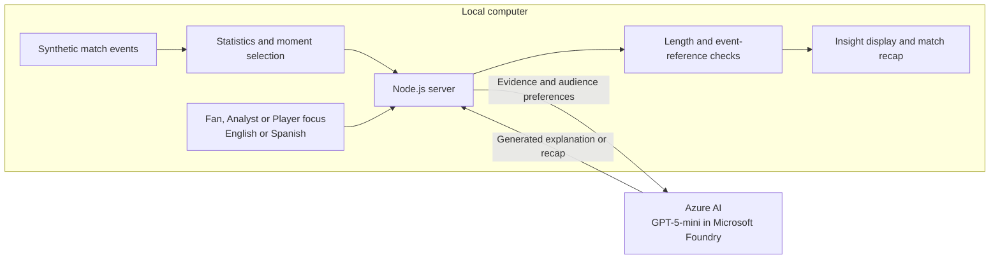

# MatchLens

MatchLens helps fans understand the story behind the score. It transforms fictional football events into live statistics, evidence-backed explanations and personalized match recaps. Fans can choose plain-language commentary, analyst detail or player-focused stories in English or Spanish.

Built with Node.js and GPT-5-mini deployed through Microsoft Foundry on Azure, MatchLens combines deterministic football calculations with AI storytelling. The prototype runs locally and calls Azure for model inference.

## What it does

- Replays a deterministic synthetic football match.
- Calculates score, shots, completed passes, pass accuracy and high regains.
- Detects goals, shooting opportunities, repeated high regains and passing patterns.
- Generates explanations using GPT-5-mini deployed through Microsoft Foundry.
- Provides supporting event references.
- Supports Fan, Analyst and Player focus modes.
- Generates English and Spanish insights and recaps.
- Supports automatic insight requests and an end-of-replay AI recap.
- Exports rule-based overlay data as JSON.

## Architecture

Synthetic event generator → deterministic statistics and moment selection → Azure-hosted AI model → local viewing interface.

The Node.js application server and interface run locally. Model inference runs on Azure. Azure App Service hosting has not been completed because of subscription quota restrictions.

Story selection uses deterministic rules; this version does not implement autonomous multi-agent orchestration.

## Run locally

Requires Node.js 24 LTS and access to an Azure model deployment.

1. Clone this repository and open its folder.
2. Run `powershell -NoProfile -ExecutionPolicy Bypass -File .\setup-azure.ps1`.
3. Enter your own Azure API key at the hidden prompt.
4. Run `npm start`.
5. Open http://127.0.0.1:3000.

No third-party package installation is required.

The current Azure endpoint and deployment name are configured in `server.mjs`. To use your own Foundry resource, replace the endpoint and model deployment name with yours.

Alternatively, supply the key through the server environment variable `AZURE_AI_API_KEY`.

Never commit API keys. The local `.azure.local.json` file is excluded by `.gitignore`.

## Use the demo

Choose a perspective, player and language. Start playback or seek to a moment.

Use **Ask MatchLens AI** for a single explanation or enable automatic insights. Automatic insights are limited to six attempts per page load, with a cooldown.

Use **Generate AI recap** to summarize the observed match. With automation enabled at playback completion, one final recap is scheduled per page load.

AI requests consume the Azure account’s available credit or incur applicable usage charges.

## Synthetic data

All clubs, players and events are fictional. No real Premier League match data is included.

The scripted replay includes passes, pressure, possession changes, high regains, shots and restarts. It is a shortened demonstration, not a regulation 90-minute simulation.

## Validation

Run `npm test`.

Tests cover deterministic replay, event identifiers, clock and coordinate bounds, score consistency, receiver links, recovery and restart relationships, player story selection and recap context.

Generated explanations are checked for length, selected internal labels and event-reference validity. These checks do not fully verify numerical or factual accuracy.

## Limitations

The simulation uses simplified player roles and scripted passages. It does not analyze video, measure speed or calculate expected goals or possession percentage.

Automatic scheduling can skip moments during cooldowns or active requests. Browser-side request limits are not production-grade spending controls.

Overlay JSON currently describes rule-based insights; synchronized broadcast integration and AI overlay export remain future work.
